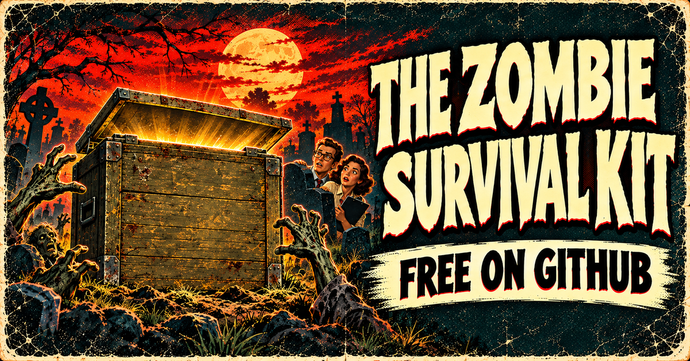

# Zombie Product Survival Kit

> Lose the legacy product, without losing the legacy customer.

**7 skills: the whole zombie-to-exit loop, six individual skills, and an action-planning worksheet.**

For Product Managers, product leaders, and product teams dealing with products that stopped earning their keep but somehow keep getting funded. Find the full cost, prepare a **Retain, Revive, Replace, or Retire** decision, protect customers through the transition, and give the freed capacity somewhere useful to go.

**Ugly is not dead. Declining is not a verdict.** Start with evidence before ordering the headstone.

## Start here

In Claude Code, open this Project as your working folder and try:

```text
/eol-run-zombie-to-exit
Classic Reports is a fictional reporting portal for fleet operations managers.
Revenue has fallen for three years and support load is rising.
Use guided questions. Label missing evidence and assumptions.
Stop for my retain, revive, replace, or retire decision.
```

Replace the fictional product with your own situation when you are ready. Do not treat the sample's figures or dates as customer evidence.

**Other assistants:** provide [the loop instructions](skills/eol-run-zombie-to-exit/SKILL.md), its [output template](skills/eol-run-zombie-to-exit/template.md), and the companion skill files it calls for. If commands are not discovered, ask the assistant to read those files directly, or copy their contents into the conversation.

[How to use the skills](skills/README.md#how-to-use-a-skill) · [Fictional worked example](skills/eol-run-zombie-to-exit/examples/sample.md) · [Excel worksheet](https://github.com/Productside/Productside-Zombie-Survival-Kit/raw/refs/heads/main/templates/EOL-Action-Planning-Worksheet.xlsx) · [Markdown worksheet](templates/EOL-Action-Planning-Worksheet.md)

Try the [three-prompt Classic Reports manual demo](demos/classic-reports.md): a fictional 1994 fintech report, $75K operating cost, the Rust rewrite mandate, and a prepared requirement-change reveal. Compare all four motions, make the human choice, then follow its branch.

No assistant? Use the worksheet by hand. Excel includes a four-motion decision worksheet, a fictional Replace example, and separate Replace and Retire tabs.

## The skills

Use one skill for the decision in front of you, or the loop to carry the same context through the sequence.

| Step | Skill | Use it to | Leaves you with |
|---|---|---|---|
| Whole loop | [eol-run-zombie-to-exit](skills/eol-run-zombie-to-exit/SKILL.md) | Work through one aging product without re-pasting every answer | Zombie-to-Exit Pack and decision log |
| Lifecycle | [eol-util-plc-mapper](skills/eol-util-plc-mapper/SKILL.md) | Check whether the product's approach fits its lifecycle stage | PLC Strategy Map |
| Recognize | [eol-step1-zombie-id](skills/eol-step1-zombie-id/SKILL.md) | Separate a zombie from a healthy, declining, or merely dated product | Zombie ID Card |
| Count the cost | [eol-util-cost-ledger](skills/eol-util-cost-ledger/SKILL.md) | Count what it earns, what it eats, and what it prevents | Cost Ledger |
| Decide | [eol-step2-revive-or-replace](skills/eol-step2-revive-or-replace/SKILL.md) | Prepare an evidence-backed recommendation for one named Decider | Decision Record |
| Plan Replace or Retire | [eol-step3-comms-plan](skills/eol-step3-comms-plan/SKILL.md) | Sequence conversations and actions for the selected motion | Replacement Launch and Exit OR Retirement Closure Worksheet |
| Free the living | [eol-step4-free-the-living](skills/eol-step4-free-the-living/SKILL.md) | Redirect the freed people, money, and roadmap room | Capacity Transfer |

The announcement companion, [eol-message](https://github.com/deanpeters/Product-Manager-Skills/tree/main/skills/eol-message), is part of Dean Peters' separate Product Manager Skills collection. It is linked, not bundled. The loop provides a labeled fallback when it is unavailable.

Each skill includes instructions, a blank template, and a worked example following the same fictional product, **Classic Reports**. See the [skill guide](skills/README.md) for handoffs and usage details.

## The zombie-to-exit loop

**Recognize → Count the cost → Decide → Follow the selected motion**

The four motions are distinct:

| Motion | Meaning | Next plan |
|---|---|---|
| **Retain** | Operate the current product **as is** | Operating scope, budget/capacity ceiling, owner, review date and reconsideration triggers |
| **Revive** | **Extend** the current product | Extension hypothesis, investment, owner and evidence check |
| **Replace** | Introduce a **successor product** and phase out the old one | [Successor launch and old-product exit](skills/eol-step3-comms-plan/replace-template.md), with rollout, migration and acceptance |
| **Retire** | **Close without a successor** | [Retirement closure](skills/eol-step3-comms-plan/retire-template.md), with obligations, records, final support and customer impact |

The lifecycle map is optional. A healthy or merely dated finding can still stop the exit loop; it is not an invented Retain approval. Retain and Revive do not trigger an EOL announcement. A successor from another vendor is a Replace path. Temporary support or records access during closure does not itself supply a successor.

**The assistant recommends; humans decide.** Step 2 ranks all four motions, then stops for the named Decider's word and reason. Separate people approve operating limits, investment, communication dates, customer promises and capacity commitments. No motion automatically produces cash savings or releases people. A Cost Ledger is required before any Capacity Transfer.

Existing command names are unchanged. The worked examples and Markdown/Excel takeaways follow the four motions. The Excel file includes the decision worksheet, a fictional Replace example, and separate Replace and Retire tabs. [Current teaching revisions](evals/README.md#current-four-motion-practice-revisions) distinguish successor paths from closure; original evaluation inputs/results remain historical. Behavioral validation of the changed branches is pending.

## Five rules for surviving your portfolio

| Rule | The nightmare it helps you avoid |
|---|---|
| **Recognize the Walking Dead** | Funding it by default because nobody counted the full cost |
| **Decide: Retain, Revive, Replace, or Retire** | Letting nostalgia or the loudest voice make the call |
| **Kill the Product, Not the Customer Relationship** | Leaving loyal customers stranded at the exit |
| **Make Retirement a Team Sport** | Discovering contracts, bundles, and promises after the announcement |
| **Free the Living from the Dead** | Retiring the product while the next good bet still starves |

Legal and finance hear early. Teams carrying customer commitments align before the notice. Every customer needs a path, and every capacity transfer needs an owner.

## Pick a working mode

| Mode | Best for | Ask for |
|---|---|---|
| **Guided** | You know something is wrong but need help working through it | Questions one at a time |
| **Context dump** | You have notes, metrics, obligations, and a pile of opinions | Sort what is known, assumed, missing, and conflicting |
| **Best guess** | You need a first draft and can see the gaps | Label assumptions and keep confirmations pending |

Best guess does not authorize the assistant to choose the decision or invent financial figures.

## Learn from real product decisions

Explore ten [sourced case cards](case-studies/README.md): Atlassian's overlap and credits, Microsoft's limited security bridge, Stadia's compensation announcement, the Hipchat/Stride handoff to Slack, Netflix DVD's closure, Polaroid's production comeback through the Impossible Project, Spotify Car Thing's shutdown remedies and community reuse, Revolv's cloud-dependent hub closure, Internet Explorer's replacement by Edge with legacy compatibility, and the Citrix–LogMeIn divestiture and reported transition plan. Each separates documented facts, teaching interpretations and unknown outcomes. The paired fictional exercises test decisions without inventing private facts about the real companies.

Use the [Customer Transition Scorecard](templates/Customer-Transition-Scorecard.md) to track the customer job, costs, data/support, blocked accounts and capacity trade—with owners, acceptance conditions and evidence of actual outcomes.

## Try ten fictional scenarios

[The Last Envelope](evals/cases/01-the-last-envelope.md) and [The Second Exposure](evals/cases/02-the-second-exposure.md) draw on DVD-by-mail holdouts and instant film's comeback. Their products and evidence are invented. Eight more cases test extension opportunities, incomplete successors, competing investments, conflicting records, external vendors, overlap/credits, limited support and compensation. Can the loop distinguish a zombie from a product that deserves to live—and protect customers through the resulting decision?

The [scenario guide](evals/README.md) includes run prompts and separate evaluator criteria. [Verification](evals/VERIFICATION.md) records the behavioral runs, findings, corrections, and remaining limits.

## Saw it in the webinar?

This is the companion kit for Productside's **Post Launch Success Series (Part 1): How to Kill Zombie Products**, October 28, 2026, with Dean Peters and Kenny Kranseler.

Take the [whole loop](skills/eol-run-zombie-to-exit/SKILL.md) back to your team, try the [Classic Reports example](skills/eol-run-zombie-to-exit/examples/sample.md), or start with the [worksheet](templates/EOL-Action-Planning-Worksheet.md).

## Use with judgment

All examples are fictional; figures, dates, and decisions are illustrative. Outputs are drafts. Verify evidence and calculations, and have the responsible people review commitments before acting. Planning intervals are defaults, not promises for your customers.

Start with public or fictional information. Use an organization-approved environment for confidential context, and keep completed plans outside this public Project.

For local Claude Code use, clone or download this Project and open that folder. The included `.claude/skills` link points to the skill folders. If your download or system does not preserve it, use the direct-file or copy-and-paste route above. File checks do not establish assistant-specific behavior or real-world outcomes.

## About Productside

Digital takeaways and examples that demonstrate and extend Productside's classes, workshops, webinars, consulting, and advisory services.

[Explore Productside](https://productside.com/) · [Training](https://productside.com/product-management-courses/) · [Tools and templates](https://productside.com/tools-and-templates/)

## License

Copyright © 2026 **280 Group LLC dba Productside**. Materials use [CC BY-NC-SA 4.0](LICENSE): preserve attribution and follow its noncommercial and share-alike terms. The separately linked `eol-message` skill carries its own attribution and license.

Provided **as is**, as instructional material, without warranties or a commitment to ongoing support. The content license grants no rights to Productside's names or logos; see [Trademarks](TRADEMARKS.md).

[Privacy Policy](https://productside.com/privacy-policy/) · [Terms & Conditions](https://productside.com/terms-conditions/)
